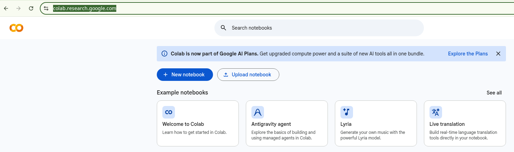
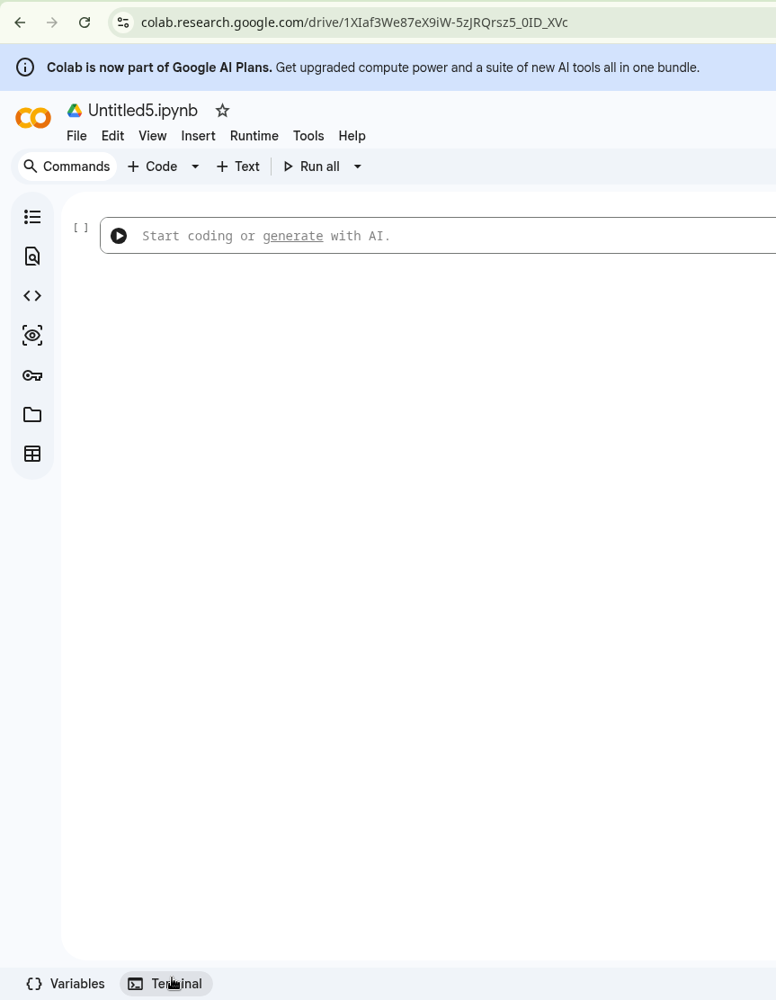
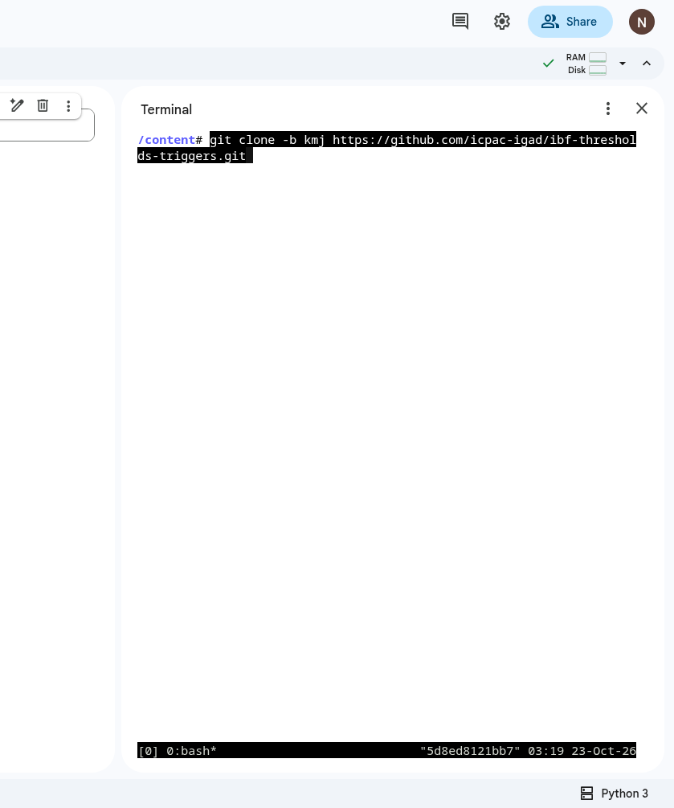

# Hands-on: drought thresholds and triggers for October-December 2026

*9th Foundational Climate Prediction Training Workshop, ICPAC · Hands-on: evaluating drought triggers and thresholds
(targeting seasonal forecasting) · 60 minutes*

Four short Python scripts take you through the threshold-and-trigger chain of the ICPAC drought anticipatory-action
system (the `kmj` branch of [ibf-thresholds-triggers](https://github.com/icpac-igad/ibf-thresholds-triggers)). They
use cloud-native (ARCO) stores, read anonymously, so nothing has to be downloaded in advance:

1. **Threshold:** how dry an October-December (OND) season has to be to count as "extreme", from 45 years of
   observed SPI-3.
2. **Forecast:** SPI-3 for OND 2026, computed with xclim from the 51 members of the SEAS5 forecast started on
   1 September 2026.
3. **Trigger:** the share of members below the threshold, and the probability at which to act, tested on 1991-2020.

The exercises work for any area of the eastern Horn. Set your own town and box once, in `exercises/common.py`.
Every map shows the admin-1 boundaries of the ICPAC countries (`data/icpac_adm1v3.geojson`), with a small East Africa
map that marks the box in red.

## Data

| Store | What | Layout | Used in |
|---|---|---|---|
| `source.coop/e4drr-project/observations/era5_ecmwf_pencil` | ERA5 SPI-1 to SPI-48, monthly 1940-2026, 0.25° | Zarr, **pencil** chunks (1033 months × 5 × 5) | 1, 2 |
| `source.coop/e4drr-project/observations/era5_ecmwf_rp_icechunk` | SPI drought thresholds for 3-50 year return periods | Icechunk, **pan** chunks (one map) | 1, 2 |
| `source.coop/e4drr-project/forecasts/seas51_tp_icechunk_v2` | SEAS5 monthly rainfall, **East Africa only**, 1°, 51 members, starts 1981-01 to 2026-09, 6 forecast months | Icechunk, small regional chunks | 3 |

SPI-3 labelled December is the standardised October + November + December total.

The SEAS5 starts 2026-05 to 2026-09 were added to the East Africa store from the daily SEAS5 forecasts of
Planette (`s3://planette-c3s-seasonal-forecasts/seas5_ic/forecast`), averaged to monthly means
by `tools/append_planette_monthly.py`. That store's chunks cover the whole globe, so the East Africa box alone would
read about 500 MB per start; the regional monthly store gives the same numbers in a few MB.

## Setup on Google Colab

**Step 1.** Open <https://colab.research.google.com/> and click **New notebook**.



**Step 2.** Click **Terminal** at the bottom of the notebook page.



**Step 3.** In the terminal, get the exercises:



```bash
git clone -b kmj https://github.com/icpac-igad/ibf-thresholds-triggers.git
cd ibf-thresholds-triggers/exercises-fcptw9
uv sync                                  # Python environment for the exercises (Colab has uv)
```

**Step 4.** Put your key in `~/.env`. Replace `<your OpenRouter key>` with the key from your email, so the line reads
`OPENROUTER_API_KEY=sk-or-...`. Never paste the key into the agent's chat.

```bash
cat > ~/.env <<'END'
OPENROUTER_API_KEY=<your OpenRouter key>
ORI_FORCE_OPENROUTER_API_KEY=1
ORI_MODEL=qwen/qwen3-coder-next
END
chmod 600 ~/.env
```

**Step 5.** Install Claude Code and Ori (OpenRouter's launcher, which runs Claude Code with your key):

```bash
echo 'export PATH="$HOME/.local/bin:$PATH"' >> ~/.bashrc; export PATH="$HOME/.local/bin:$PATH"
curl -fsSL https://claude.ai/install.sh | bash
curl -fsSL https://openrouter.ai/labs/ori/install.sh | bash
claude --version; ori --version
```

**Step 6.** Start Claude Code in the `exercises-fcptw9` folder:

```bash
set -a; source ~/.env; set +a
ori claude --model qwen/qwen3-coder-next
```

**Step 7.** Give it this prompt:

```text
Check the Python scripts in the @exercises/ folder. Run them one after another, report the outcome of each,
and explain briefly, for a beginner, what each script does.
```

Colab resets the machine after about 90 minutes without activity, and `~/.env` is lost too. Then repeat steps 3 to 6.
To go back to an earlier conversation, add `--continue` to the `ori claude` line.

To run without the agent, on Colab, JupyterHub or a laptop: `uv run python exercises/01_open_spi_stores.py`, then 02,
03 and 04. If `uv` is missing, install it with `curl -LsSf https://astral.sh/uv/install.sh | sh` (no sudo needed).
The exercises need Python 3.12 or later, because of icechunk 2.

## The 60 minutes

| Time | Script | Question | Look for |
|---|---|---|---|
| 0-5 | | Introduction: threshold, forecast probability, trigger | |
| 5-15 | `01_open_spi_stores.py` | Load: how dry were past OND seasons at my town? | 1 chunk for an 86-year series; the driest years (2025, 2010, 1998, 2005, 2022 at Garissa) |
| 15-25 | `02_ond_thresholds.py` | Threshold: what is a 1-in-5 and a 1-in-10 year dry OND, pixel by pixel? | Empirical vs fitted thresholds; OND vs all-months thresholds; masked dry-season pixels |
| 25-45 | `03_seas5_ond_spi3.py` | Forecast: what SPI-3 does SEAS5 give for OND 2026? | xclim gamma fit on the model's own climatology; the spread of the 51 members |
| 45-60 | `04_trigger_probability.py` | Trigger: at what probability would we act, and where does it trigger in 2026? | Hit rate vs false alarms per trigger; the dotted "act" map |

Run each script with `uv run python exercises/0N_....py`. Plots go to `out/`.

**The chunk layout decides the cost.** In exercise 1 an 86-year series at a point is a single pencil chunk. In
exercise 3 the forecast comes from a regional monthly store: a few MB for the whole of East Africa. The same forecast
read from Planette's global daily store would cost about 500 MB, because every chunk there covers the whole globe.

## Things to check (and discuss)

- **Units.**
  - SEAS5 `pr` is a daily mean rate (kg m⁻² s⁻¹ = mm s⁻¹): × 86400 gives mm per day.
  - SPI has no units.
- **Lead time.** For a 1 September start, lead day 1 is 1 September, so OND is lead days 31-122.
- **Latitude order.** Both stores list latitude from north to south.
- **Two different climatologies.**
  - The threshold comes from ERA5 (1981-2025).
  - The forecast SPI comes from the model's own September starts (1991-2020, 25 members).
  - SPI makes the two comparable: each is "how unusual for its own record".
- **The trigger test is in-sample.** The 30 test seasons (1991-2020, 25 members, so steps of 4%) are the same years the
  SPI was fitted on. The hindcast has 25 members and the 2026 forecast has 51.
- **Comparison with the `kmj` branch.**
  - A 1-in-5 year threshold corresponds to SPI-3 ≈ −0.84, one of the `kmj` thresholds (`--thresholds="-0.68,-0.84"`).
  - Compare the trigger chosen here with the `kmj` trigger of 15.2%.

## Going further

- Set `RETURN_PERIOD = 10` in exercise 4. What happens to the hit rate, and to the area triggered?
- Move `BOX`, `TOWN`, `LAT` and `LON` in `common.py` to your own country, and rerun exercises 1-4.
- Average the probability over a district or county instead of using pixels (see `08-kmj-district-stats.py`).
